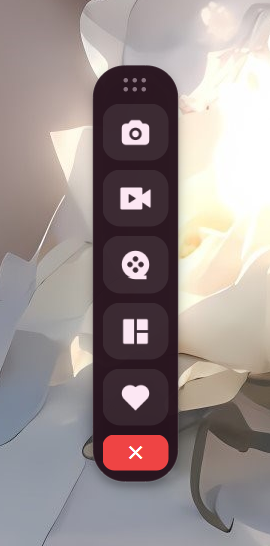
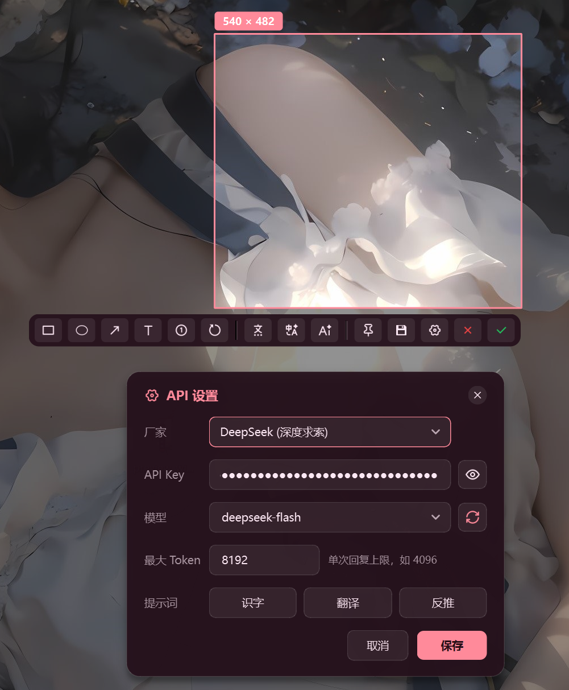
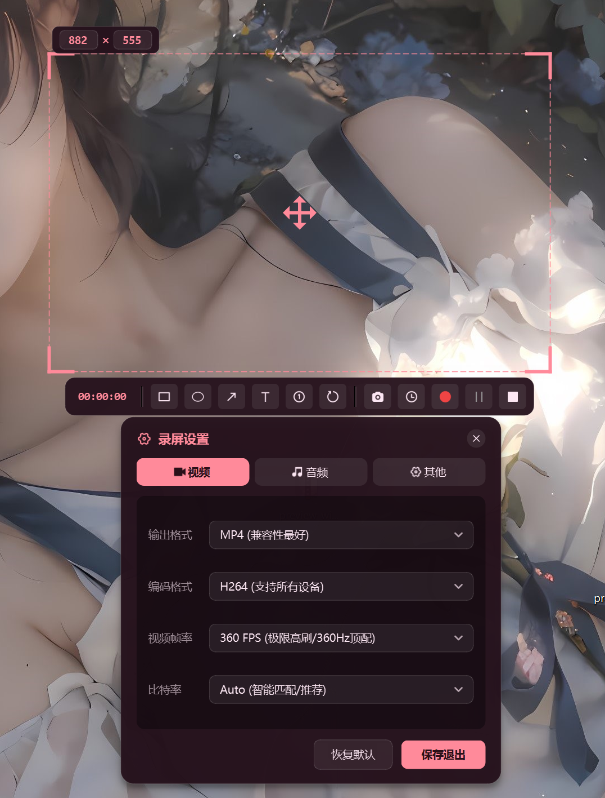
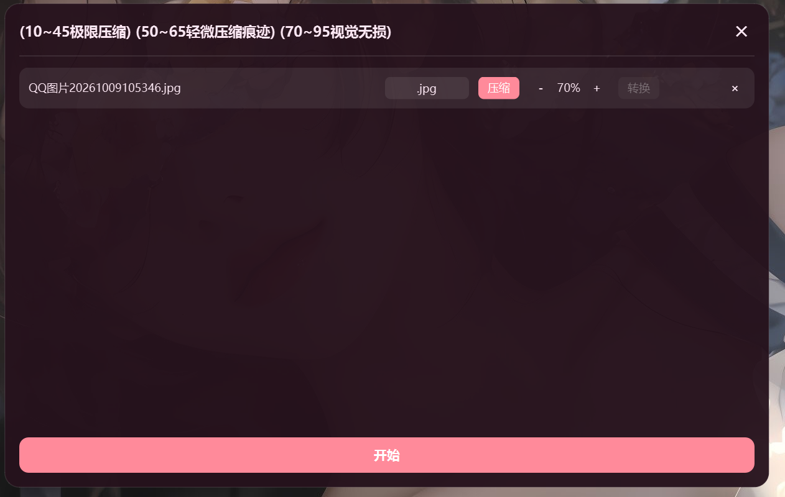

# 🚀 Alili 媒体工具箱
### 基于 **ffmpeg** 的一体化桌面媒体工具集，全局悬浮窗一键触达

[📺 基础功能教程](#-基础功能教程) • [✨ 功能亮点](#-功能亮点) • [❓ 常见问题](#-常见问题)

---

| 平台 | 下载方式 |
| :--- | :--- |
| 🪟 Windows |  &nbsp;&nbsp;  |

提供便携版（standalone）压缩包，解压即用，ffmpeg 已内置。

## 📖 项目简介

**Alili 媒体工具箱** 把日常创作中最常用的媒体处理能力打包成一个常驻桌面的悬浮窗工具集：AI 智能截图、高清录屏、拼图布局、格式转换，全部基于 ffmpeg 内核，零外部依赖、开箱即用。随手一点，灵感即刻留存。

---

## ✨ 功能亮点

### 🤖 AI 智能截图
- 区域 / 全屏截图，叠加 AI 识别与处理。
- 默认**自动保存 + 复制到剪贴板**，截图即贴即用。

### 🎬 桌面录屏
- 系统声音 + 麦克风双音源录制，教程 / 演示全覆盖。
- 预设 **MP4 / H264 / 60FPS**，音频 **AAC / 320kbps** 高保真。
- 显示鼠标光标（录制教程更清晰），智能硬件加速（优先 DX11 显卡直通）。

### 🧩 拼图布局
- 多图智能拼接与布局合成，一键生成长图、对照图、九宫格。

### 🔄 格式转换
- 音视频格式互转，支持批量处理，转码参数可自定义。

### 🪟 全局悬浮窗
- `widget.py` 常驻桌面，随手调用任意工具，不打断当前工作流。

### ⚙️ 配置预设
- `recorder_config.json` 一键套用录制参数，参数模板化管理。

### 🔄 自动更新
- `updater_client` 增量更新机制，保持工具箱始终最新。

### 📦 零依赖打包
- PyInstaller 便携版，ffmpeg 内置，无需单独安装任何运行环境。

---

## 📸 界面预览

<!-- 截图请放置于 docs/ 目录后替换下方路径 -->
| 悬浮窗入口 | AI 截图 |
| :---: | :---: |
|  |  |
| 全局快捷触达 | 区域 / 全屏 + AI |

| 桌面录屏 | 拼图布局 |
| :---: | :---: |
|  |  |
| 高保真录屏 | 多图合成 |

> 💡 截图占位：请将实际软件截图放入 `docs/` 目录，并替换上方文件名即可自动生效。

---

## 📺 基础功能教程

> 完整视频教程正在筹备中，可先关注作者 B 站主页获取最新动态：
>
> 👉 **B 站教程空间**：https://space.bilibili.com/67359822
>
> （具体教学视频上线后，此处会补充对应分集链接。）

**图文速览：**
1. 双击「打开悬浮窗.bat」（或运行 `widget.py`）唤出全局悬浮窗。
2. 选择「截图 / 录屏 / 拼图 / 格式」任一功能。
3. 录屏前可在 `recorder_config.json` 中调整码率、帧率、音源等参数。
4. 产物默认保存到 `./media/` 目录，自动按类型归类。

---

## ❓ 常见问题

**Q：需要单独安装 ffmpeg 吗？**
> 不需要。ffmpeg 已随包内置，开箱即用，无需配置环境变量。

**Q：悬浮窗打不开？**
> 双击根目录的「打开悬浮窗.bat」，或在 Python 环境下直接运行 `widget.py`。若提示缺失依赖，请确认已安装 PySide / PyQt 运行库。

**Q：录屏没有声音？**
> 请检查 `recorder_config.json` 中的 `audio_src` 设置，确保选择了正确的音源（系统声音 / 麦克风 / 混合）。

**Q：截图 / 录屏保存在哪？**
> 默认保存到程序同级 `./media/` 目录，截图同时会复制到剪贴板，可直接粘贴使用。

**Q：支持 macOS / Linux 吗？**
> 当前版本为 Windows 专属，其他平台版本正在规划中。

---

## 📄 开源协议

本项目**免费**提供使用。作者：**阿里里**。

⭐ 如果这个项目帮到了你，欢迎 Star 与分享！
